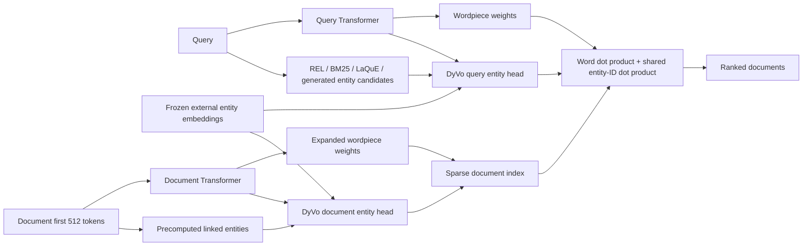

# DyVo extension plan: exact pipeline changes

**Status: design for review, 24 September 2026.** This document specifies the extensions shortlisted after reading the complete professor-provided [DyVo paper](/Users/parav29/Documents/ChatGPT/DyVo/cs6101_DyVo.pdf) and completing the [research council review](/Users/parav29/Documents/ChatGPT/DyVo/research/DyVo-research-council-report.md). No extension has been implemented or shown to improve retrieval. “DyVo” is the paper's name; the request's “BYVO” refers to this same system.

## What we are choosing

We plan **two core extensions** to a reproduced DyVo baseline:

1. **E1 — document-utility-trained query entity selection:** change which entity IDs are sent to DyVo for a query.
2. **E2 — evidence-grounded document entity repair:** change which entity IDs are assigned to documents and entered into the sparse index.

A **third extension, E4 — version-consistent entity refresh**, is conditional on obtaining genuine dated document collections, entity snapshots and relevance judgments. Two alternatives remain on the shortlist: **E3 — cost-aware entity selection** for a constrained laptop or as E1's efficiency experiment, and **E12 — score-aware entity embedding compression** only if memory profiling exposes a real problem that ordinary compression cannot solve. We will not present five variations as five completed contributions. E1 and E2 change different sides of DyVo's entity match; that is why they form the main pair.

| Status | Extension | DyVo stage changed | Primary objective | What it replaces |
|---|---|---|---|---|
| **Core 1** | E1: utility-trained query entity selector | Query candidate generation/selection, **before** DyVo's query entity head | Better document ranking with cheaper online candidate selection | Direct expensive generation or generic top-K entity retrieval in the chosen comparison; original methods remain baselines |
| **Core 2** | E2: grounded document entity repair | Offline document candidate generation and, in one ablation, document entity scoring; **before** indexing | Better entity matching to relevant documents | Linked-only document candidate lists in an experimental index |
| **Conditional third** | E4: version-consistent refresh | Entity catalog, candidate search, embedding rows, affected document postings | Retrieval of newer entities at measured update cost | Treating a static catalog/index as sufficient after knowledge changes |
| **Resource alternative / E1 efficiency arm** | E3: cost-aware support policy | Query orchestration **before** an expensive source, and/or query support **after** candidate retrieval | Lower end-to-end cost while retaining retrieval quality | One fixed, always-on entity source and fixed support budget |
| **Reserve** | E12: score-aware entity embedding compression | External embedding storage/row lookup feeding DyVo's entity heads | Lower memory at retained retrieval quality | Full-precision entity row storage, only if simpler fp16/int8 is inadequate |

## DyVo pipeline that stays our baseline



DyVo's word model, candidate-restricted entity head, external entity embeddings and sparse dot-product retrieval are the starting point. An entity contributes only when query and document representations contain the **same canonical entity ID** with positive weights. The paper compares several **query** candidate sources but holds **document** entities to linked candidates across its reported experiments. BM25/LaQuE use top 20 candidates; generated lists are variable after catalog filtering. Documents are truncated to 512 input tokens in the published experiments. [Nguyen et al., DyVo, EMNLP 2024](https://aclanthology.org/2024.emnlp-main.45/)

The baseline must be established before interpreting extension gains. The public release has core model code and initialization assets, but the inspected asset manifest did not include final target-trained checkpoints or ready indexes. Corpus access is another prerequisite. These are reproduction gates, not changes counted as extensions. [Official code](https://github.com/thongnt99/DyVo), [replication audit](/Users/parav29/Documents/ChatGPT/DyVo/research/agent5-replication.md)

## Core extension 1 — select query entities for document utility (E1)

**Why this extension.** DyVo can receive semantically plausible entities that do not help distinguish relevant documents. A generated candidate may have no matching document posting, or it may occur so broadly that it adds noise. The paper itself suggests distilling LLM entity generation into a smaller ranker, so plain imitation is a baseline, not our complete contribution. We want to test whether training the small selector on **document retrieval consequences** produces a better quality/cost trade-off than training it simply to copy a teacher's entity list. [DyVo Limitations](https://aclanthology.org/2024.emnlp-main.45/), [DREQ, ECIR 2024](https://arxiv.org/abs/2401.05939), [BLINK, EMNLP 2020](https://aclanthology.org/2020.emnlp-main.519/)

**Placement.** On the query path, after a cheap candidate pool is constructed and canonicalized, **before** DyVo computes query entity weights. The document encoder and existing document index stay fixed in the first experiment.

```text
Original: Query → REL/BM25/LaQuE or LLM candidates → canonical IDs → DyVo entity head → sparse retrieval
Proposed: Query → cheap candidate pool → utility-trained selector → canonical IDs → same DyVo head → same sparse index
```

**What it replaces.** At inference, the compact selector replaces the selected baseline's direct expensive entity generation or generic top-K choice. It does **not** replace DyVo's Transformer, entity-weighting equation, word branch or document index. The original generator remains a comparison arm. A selector that only reranks a pool cannot recover an entity absent from that pool; candidate-pool coverage is therefore measured separately.

**What exactly is trained.** On training queries only, compute each candidate entity's simple contribution to relevant-versus-negative document scores under a frozen DyVo baseline. For a relevant document \(d^+\) and negative \(d^-\), the direct margin contribution is \(s_e(q)[s_e(d^+)-s_e(d^-)]\). Compare this simple target with document-occurrence labels, LLM-list imitation and more complex multi-document or set-conditional utility targets. A single-pair leave-one-out logistic-loss target is monotonic in the direct margin contribution; it cannot be claimed as a new objective without showing an advantage across multiple documents or entity interactions. Train a small ranker using query text, candidate entity description/embedding and legitimate training-corpus support features. Never derive labels from evaluation-query judgments. [JointSem, CIKM 2017](https://www.cs.cmu.edu/~hovy/papers/17CIKM-SemQA.pdf), [2026 entity-signal analysis, arXiv v2](https://arxiv.org/html/2604.05204v2)

**Code location once approved.** Add a training-only utility-target builder and a query candidate selector around [`lsr/entity/bert_candidates.py`](https://github.com/thongnt99/DyVo/blob/1b30d6c445f97722440ab0af1644ffd56d8fc00c/lsr/entity/bert_candidates.py) / [`precomputed_candidates.py`](https://github.com/thongnt99/DyVo/blob/1b30d6c445f97722440ab0af1644ffd56d8fc00c/lsr/entity/precomputed_candidates.py), feeding the existing collator and [`mlp_emlm.py` query head](https://github.com/thongnt99/DyVo/blob/1b30d6c445f97722440ab0af1644ffd56d8fc00c/lsr/models/mlp_emlm.py). These new modules do not yet exist. Preserve candidate rank, source, score and canonical ID; the released cached-candidate loader is not a live retriever for an unseen query.

**Proof required.** Compare identical candidate pools, final K, selector capacity, training examples, negatives and training steps. Report nDCG@10/20, Recall@1000, unseen-entity performance, complete uncached query latency and the offline cost of teacher labels. If document-utility training does not beat the best simple label and imitation controls, the more complex training claim fails. In the no-paid laptop path, released training resources may support **utility learning**, but without legitimate teacher labels we cannot claim to have retained GPT-level benefit.

## Core extension 2 — repair document entity support with local evidence (E2)

**Why this extension.** Query-side improvement cannot create an entity match when a relevant document lacks that entity in the index. DyVo's reported experiments keep document candidates linked-only. The proposed change targets this missing-support bottleneck, but first we must measure how often it occurs on development data. Generic addition of more document entities already has prior art; the specific question is whether **supported, selective additions** yield more useful matches for a fixed index budget. [Early Stage Sparse Retrieval with Entity Linking, CIKM 2022](https://arxiv.org/abs/2208.04887), [CASPER, current preprint](https://arxiv.org/abs/2508.13394)

**Placement.** On the offline document path, **before** the document DyVo entity head and sparse index build. An optional second change restricts entity scoring to document spans that support the candidate. We will test candidate repair and local scoring separately.

```text
Original: Document text → linked entity IDs → document DyVo entity head → document entity postings
Proposed: Same document text → linked + retrieved entity proposals → evidence check + posting budget
          → document DyVo entity head (optionally local evidence scoring) → rebuilt entity postings
```

**What it replaces.** The experimental document index uses grounded, budgeted candidate lists in place of linked-only lists. It does **not** replace the word encoder, query encoder or sparse retrieval engine. Every document representation affected by the change must be re-encoded/reindexed. The original linked-only index remains the direct baseline.

**What qualifies as grounded.** Record a supporting document span or section, entity ID and support type (mention, alias, or evidence for an implicit concept). A generator's confidence alone is insufficient. Inspect a blinded sample independently. The first controlled run uses exactly the same first 512 document tokens as DyVo. Later full-document/window experiments must give the lexical and linked-entity baselines the same extra text. [Adapting Learned Sparse Retrieval for Long Documents, SIGIR 2023](https://arxiv.org/abs/2305.18494), [BERT-ER, SIGIR 2022](https://www.cs.unh.edu/~dietz/appendix/fp0617-chatterjee-bert-er.pdf)

**Code location once approved.** Add an offline document proposal/evidence builder that emits canonical IDs plus evidence offsets. Extend [`lsr/datasets/text_entity_collator.py`](https://github.com/thongnt99/DyVo/blob/1b30d6c445f97722440ab0af1644ffd56d8fc00c/lsr/datasets/text_entity_collator.py) to carry optional evidence masks and the document encoder in [`lsr/models/mlm_emlm.py`](https://github.com/thongnt99/DyVo/blob/1b30d6c445f97722440ab0af1644ffd56d8fc00c/lsr/models/mlm_emlm.py) to score locally for that ablation. Build a separately named entity index for each document-candidate/scoring variant. The evidence builder and masking code are proposed, not present in the release.

**Proof required.** Run the 2×2 design: linked or expanded query candidates × linked or repaired document candidates. Compare alias-only repair, ordinary unfiltered expansion and supported repair with identical visible text and matched **total entity postings/index bytes**. Measure nDCG@10/20, Recall@1000, relevant and nonrelevant entity overlap, unsupported additions, index size and offline build cost. If supported repair has no useful overlap headroom, or alias/simple expansion performs equally well at the same budget, this mechanism fails.

## Conditional third — refresh the whole entity channel consistently (E4)

**Why this extension.** DyVo motivates a dynamic vocabulary but does not provide a controlled test of knowledge updates. A newly added embedding row is useless unless query candidate search can emit the new canonical ID and the document index has appropriate postings. Updating an existing embedding can also make stored document weights stale. Dynamic entity embeddings without retraining already exist in dense retrieval, so our narrower question is whether a **sparse entity index** can be updated consistently and selectively at a useful cost. [TempEL, NeurIPS 2022](https://arxiv.org/abs/2302.02500), [DynamicER, EMNLP 2024](https://aclanthology.org/2024.emnlp-main.762/), [KPR, Findings EMNLP 2025](https://aclanthology.org/2025.findings-emnlp.915/)

**Placement.** Across the catalog and index maintenance path: canonical ID/alias mapping → candidate retrieval catalog → frozen entity embedding rows → affected document entity weights/postings. The baseline word model can stay frozen.

```text
Original: Static entity catalog + embeddings + document links → one fixed DyVo entity index
Proposed: Dated catalog changes → update IDs/aliases and candidate search → update embedding rows
          → find affected documents → repair their entity postings → publish one versioned index
```

**What it replaces.** It replaces the assumption that a fixed catalog and document entity index remain adequate after a knowledge update. It does **not** replace the DyVo encoder or its scoring method. Existing document postings for changed entities may be found through an inverse association; newly created entities need a separate document-discovery/backfill method, potentially a broad scan. All discovery, encoding and write work counts in the update cost.

**Code location once approved.** Add a versioned ID/alias manifest around [`lsr/models/entity_emb.py`](https://github.com/thongnt99/DyVo/blob/1b30d6c445f97722440ab0af1644ffd56d8fc00c/lsr/models/entity_emb.py) and the candidate loaders, plus a delta document-entity export/index update path. Check the release's wordpiece/entity ID offset before appending IDs. The index refresh path is new; the released scripts do not demonstrate this end-to-end procedure.

**Activation gate and proof.** Implement as the third extension only if we can secure actual \(t_0/t_1\) entity and document snapshots plus temporally valid **document-relevance** judgments. Compare stale, alias-only, catalog/candidate-only, selective-posting and full-posting refresh under the same frozen encoder. Report new/changed/stable query nDCG@10/20 and Recall@1000, old-query regression, documents/postings touched, bytes and complete update time. A randomly hidden known entity tests unseen-vocabulary induction; it does **not** prove temporal freshness. If selective maintenance costs nearly as much as full refresh or gains vanish against alias-only updating, withdraw the selective-refresh claim.

## Resource alternative — cost-aware entity support (E3)

**Why it remains shortlisted.** The paper's top-20 BM25/LaQuE setting does not ask whether a particular query benefits from 0, 5 or 20 entity coordinates. Popular entities can incur long posting lists. A policy may help a laptop or a low-latency deployment, but adaptive sparsity and document-frequency-based cost control already have strong precedents. [Static Pruning, SIGIR 2023](https://arxiv.org/abs/2304.12702), [DF-FLOPS, SIGIR 2025](https://arxiv.org/abs/2505.15070), [AdaSparse, SIGIR 2026](https://sites.cs.ucsb.edu/~tyang/papers/2026SIGIR-AdaSparse.pdf)

**Placement and replacement.** A cheap **pre-source gate** can choose lexical-only, cheap entity retrieval or an expensive source before that source runs. A **post-candidate selector** can choose which scored entities enter the query vector. These are different measurements. Together they replace one always-on source and fixed support policy; they leave the stored document index unchanged.

```text
Original: Query → always run fixed candidate source → fixed K/support → DyVo query entity head → index
Proposed: Query → cheap source decision → chosen candidate source → utility/cost support policy, K may be 0
          → same DyVo query head → same index
```

**Code location once approved.** Add orchestration around the candidate loaders, preserve ranked candidate scores, and extract canonical-ID document frequencies from the built index. Instrument source calls, controller overhead and actual search work. If batch regularization is explored, aggregate by entity ID: candidate slot number alone is not a stable vocabulary dimension. The query-only variant makes no document-index-size claim.

**Why conditional.** First profile the complete live query path. If the policy can avoid only fraction \(f\) of total time, its ideal speedup ceiling is \(1/(1-f)\) before policy overhead. Compare fixed K, score/mass thresholds, DF-only pruning and a simple utility-per-cost rule at equal measured latency. If the ceiling is too small or those simple methods match the policy, keep E3 as an efficiency ablation rather than a standalone extension. Offline LLM candidate files cannot establish saved live generation time. Under laptop/no-paid resources, this can replace E1's teacher-distillation claim if it addresses a measurable local cost center.

## Memory reserve — score-aware embedding compression (E12)

**Why it remains shortlisted.** DyVo's external entity table is large; the paper's roughly 5.3 million entities × 768 float32 values imply about 16.3 GB of raw rows before other costs. Compression could matter when that table is the limiting resource. Ordinary float16/int8 or product quantization may already solve the problem, so a DyVo-specific method is justified only after measuring residual retrieval loss. [ColBERTSaR, SIGIR 2026](https://arxiv.org/abs/2606.05568), [TurboQuant, 2025 preprint](https://arxiv.org/abs/2504.19874)

**Placement and replacement.** Replace full-precision frozen entity row storage/lookup in [`entity_emb.py`](https://github.com/thongnt99/DyVo/blob/1b30d6c445f97722440ab0af1644ffd56d8fc00c/lsr/models/entity_emb.py) with a row-addressable compressed store and decode step **before** each DyVo entity head. Start with fixed candidate IDs and an unchanged document index to isolate query-score error; a consistent both-side compressed experiment must separately rebuild document entity postings. Candidate ANN compression and document inverted-index compression are different systems and are outside this first test.

```text
Original: Candidate IDs → full-precision frozen entity rows → DyVo entity head
Proposed: Candidate IDs → compressed row lookup/decode → same DyVo entity head
```

**Code location and proof once approved.** Add a compressed row store and an offline calibration/conversion process; count scales, codebooks, temporary decode buffers and any duplicated uncompressed table in **total resident bytes**. The conversion itself may exceed laptop memory, so feasibility must be checked first. Compare fp32, fp16, ordinary calibrated int8/PQ and score-aware compression at equal bytes; evaluate entity-weight error, nDCG@10/20, Recall@1000 and lookup p95. If ordinary compression meets the chosen quality and memory target, do not implement a specialized method. Fewer bytes do not by themselves prove faster retrieval or a smaller document index.

## What will count as improvement

For every candidate, the original DyVo configuration and its word-only LSR-w ancestor are measured on the **same complete document collection**, with the same query fields and evaluation rules. Paper table numbers are comparison targets, not results we have reproduced. The primary effectiveness measure is nDCG@10; nDCG@20 and Recall@1000 are required secondary measures. Report paired per-query uncertainty, entity-support diagnostics and relevant cost dimensions. Candidate accuracy alone does not prove a document-retrieval gain.

The comparison sequence is: (0) establish a verified baseline; (1) diagnose candidate and document-support headroom; (2) test E1 while document vectors are fixed; (3) test E2 with separately rebuilt document indexes; (4) combine E1+E2 only after recomputing any utility targets invalidated by the new index; (5) test E4, E3 or E12 only after its specific data, latency or memory gate passes. Training and test judgments remain separate. This order lets us identify which pipeline change caused any observed gain.

**No extension is approved for implementation by this document alone.** The [full council report](/Users/parav29/Documents/ChatGPT/DyVo/research/DyVo-research-council-report.md) contains the 25-paper table, adversarial objections, detailed experiment matrix and resource plans that support this shortlist.
