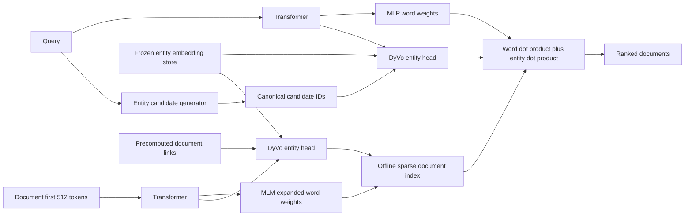

# DyVo: reproduction and extension research council

**Literature cutoff: 23 September 2026; report completed 24 September 2026. Status: research and experimental design only; no extension implementation or retrieval experiments performed.**

The foundational source is the professor-provided [17-page PDF](/Users/parav29/Documents/ChatGPT/DyVo/cs6101_DyVo.pdf), read in full, including its references, limitations, Appendix A.1–A.3 and prompts. The published record is [Nguyen et al., EMNLP 2024](https://aclanthology.org/2024.emnlp-main.45/). Paper results, observations from static code inspection, our hypotheses and proposed decision thresholds are distinguished throughout.

This is a targeted literature review with backward and forward citation tracing, not an exhaustive systematic review or proof that no similar work exists. The council uses seven separately tasked AI agents, initially working independently, followed by shared criticism and response. These are independent task contexts in the same model family, not seven human reviewers or cross-model validation. Both resource scenarios requested by the user are considered: **GPU plus paid teacher budget**, and **laptop with no paid API**. Optional Gemini Flash is a separately evaluated teacher condition, not an assumed equivalent of historical GPT-4.

## 1. DYVO IN 1 PAGE

**The problem.** A conventional learned sparse retriever assigns weights to a transformer's fixed wordpiece vocabulary. Entity names can be fragmented or ambiguous. DyVo adds canonical Wikipedia entity IDs as additional sparse dimensions, while preserving a dot-product retrieval score. Its distinctive mechanism is an output head that scores only a retrieved subset of external entity embeddings; it does not evaluate a dense output layer over millions of entities. This is the paper's contribution, rather than the invention of entity-aware retrieval or sparse neural retrieval. [DyVo, §§1–3](https://aclanthology.org/2024.emnlp-main.45/)

**Architecture.** Let \(C(x)\) be the candidate entities for a query or document, \(h_j(x)\) its contextual token states, and \(v_e\) a frozen entity embedding. Making the candidate restriction explicit, the paper's Eq. 4 is:

\[
s_e(x)=\mathbf{1}[e\in C(x)]\lambda_{ent}\max_j\log(1+\operatorname{ReLU}(v_e^\top h_j(x))).
\]

The document word branch uses an MLM expansion head with max-pooled, log-saturated positive scores. The query word branch weights input wordpieces with an MLP and combines repeated tokens; it does **not** perform the same lexical expansion as the document branch. Eq. 5 combines the two independent channels:

\[
S(q,d)=\langle w(q),w(d)\rangle+\sum_{e\in C(q)\cap C(d)}s_e(q)s_e(d).
\]

The last expression exposes a crucial constraint: different entity IDs do not directly match, even if their descriptions are similar. Semantic embedding similarity determines weights; canonical-ID equality enables the sparse entity match. This is a derivation from DyVo's equations, not a measured weakness. [DyVo, Eqs. 2–5](https://aclanthology.org/2024.emnlp-main.45/)

**What the experiments actually vary.** DyVo studies REL linking, BM25/LaQuE entity retrieval and Mixtral/GPT-4 entity generation on the **query side**. BM25 and LaQuE retrieve 20 candidates; LLM lists have variable lengths and are filtered to the entity vocabulary. Documents reuse linked entities across all these conditions. The experiments use the first 512 document tokens and a roughly 5.3-million-entity inventory formed by intersecting KILT entities with Wikipedia2Vec. Entity embeddings are frozen, with a learned projection when dimensions differ. [DyVo, §4 and Appendix A](https://aclanthology.org/2024.emnlp-main.45/)

**What is inherited.** Weighted sparse lexical representations and their training come from the LSR/SPLADE family; the asymmetric word baseline follows the authors' unified LSR work. Entity linking, external embeddings, LLM candidate generation and document-ranking distillation are ingredients. Entity-aware ranking itself substantially predates DyVo. The distinctive combination is candidate-restricted external entity scoring plus an indexable first-stage word/entity representation. [SPLADE](https://arxiv.org/abs/2107.05720), [Unified LSR](https://arxiv.org/abs/2303.13416), [Word-Entity Duet](https://arxiv.org/abs/1706.06636)

**Reported evidence.** These are paper point estimates of nDCG@10 on a 0–1 scale, converted from its tables; they are not our reproduced results.

| Model | Robust04 | Core18 | CODEC |
|---|---:|---:|---:|
| LSR-w, word L1 = 1e-5 | .4913 | .4099 | .5261 |
| DyVo REL / LaQuE embeddings | .5119 | .4372 | .5340 |
| DyVo GPT-4 / LaQuE embeddings | .5439 | .4306 | .5646 |
| DyVo GPT-4 / BLINK embeddings | .5556 | .4463 | .5815 |

Source: [DyVo Tables 1–3](https://aclanthology.org/2024.emnlp-main.45/). GPT-4/LaQuE is not best on every dataset or metric: REL is higher on Core18 nDCG@10. Do not convert point estimates into significance claims.

**What remains unproven.** The paper does not supply a controlled temporal knowledge-refresh experiment, comprehensive end-to-end latency/API-cost measurements, or index-size trade-off evaluation. Its limitations already suggest distilling expensive LLM entity selection into a streamlined ranker. Thus plain distillation would complete a stated future direction, not establish a new general concept. Appendix A.1 applies L1 to words, not entities; Appendix A.2 documents entity-weight collapse and motivates a small initial entity scale. [DyVo, Limitations and Appendix A](https://aclanthology.org/2024.emnlp-main.45/)

## 2. CLOSEST RELATED WORK

Three lines of work constrain the contribution we can defend.

**Vocabulary and first-stage entity representations.** Dudek et al. learn sparse representations over a specified expanded vocabulary; Shehata et al. already augment query/document sparse retrieval with linked entities. Later, CASPER uses token and concept/keyphrase dimensions for scientific retrieval. These make “add entities/concepts to sparse retrieval” an insufficient novelty claim. DyVo's external candidate-scored entity head remains the particular system we extend. [Dudek et al., CIKM 2023](https://research.google/pubs/learning-sparse-lexical-representations-over-expanded-vocabularies-for-retrieval/), [Shehata et al., CIKM 2022](https://arxiv.org/abs/2208.04887), [CASPER, current v2](https://arxiv.org/abs/2508.13394)

**Entity usefulness for document ranking.** JointSem jointly learns linking and document ranking. DREQ derives entity supervision from document relevance; BERT-ER builds query-specific entity representations. QDER adds query-specific multi-vector document/entity reranking. These are close conceptual competitors, though reranking and independent first-stage indexing have different constraints. We must compare the proposed utility objective against ordinary document-derived entity labels, not merely against an untrained entity retriever. [JointSem](https://www.cs.cmu.edu/~hovy/papers/17CIKM-SemQA.pdf), [DREQ](https://arxiv.org/abs/2401.05939), [BERT-ER](https://www.cs.unh.edu/~dietz/appendix/fp0617-chatterjee-bert-er.pdf), [QDER](https://doi.org/10.1145/3726302.3730065)

**Efficiency and supervision.** BLINK and MVD already distill expensive entity interactions into efficient retrieval models. Static sparse pruning and DF-FLOPS already address sparse retrieval cost. A DyVo project can adapt these mechanisms, but its defensible contribution must be a specific question about document utility, candidate support or deployment trade-offs. [BLINK](https://aclanthology.org/2020.emnlp-main.519/), [MVD](https://aclanthology.org/2023.acl-long.542/), [Static Pruning](https://arxiv.org/abs/2304.12702), [DF-FLOPS](https://arxiv.org/abs/2505.15070)

**A material later challenge.** Chatterjee's July 2026 v2 distinguishes semantic entity relevance from usefulness under the actual document annotations. It also analyzes clean versus leaked entity supervision. Its experiments concern entity-oriented rerankers; they are not a replication or refutation of DyVo. We use them to motivate coverage diagnostics and strict separation of training topics from evaluation judgments. QDER's official repository separately documents code/result corrections; its historical headline numbers should not be used as an unquestioned baseline. [2026 study, v2](https://arxiv.org/html/2604.05204v2), [QDER repository and errata](https://github.com/shubham526/SIGIR2025-QDER)

The useful distinction for our project is therefore: **which entities are plausible, which entities can reach relevant documents, and which entities improve ranking at an acceptable cost?** This is our synthesis of the above literature, not a claim that the distinction itself is new.

For precision, QDER's official errata states that its cross-validation was query-disjoint, while test-time entity candidate construction used document-relevance labels. Candidate-construction leakage can occur despite disjoint model training. We do not infer that DyVo shares this issue. [Official QDER errata](https://github.com/shubham526/SIGIR2025-QDER/wiki/Errata)

## 3. DYVO COMPONENT MAP

The diagram separates offline document work from online query work. Both entity branches require the same catalog IDs.

| Module | Published/released choice | Literature-backed alternatives | Bottleneck or assumption to investigate | Extension point / difficulty |
|---|---|---|---|---|
| Query lexical encoder | DistilBERT + input-token MLP; no word expansion | Unified LSR; inference-free Li-LSR | Encoding may dominate once other stages are cheap | Keep fixed for causal comparisons; swapping encoder alone is a baseline |
| Query candidate generation | REL, BM25, LaQuE, Mixtral, GPT-4 | BLINK bi-encoder; GENRE constrained names; utility-trained selector | Missing candidate cannot be weighted; online LLM cost; generic entity relevance differs from document utility | E1 utility selection, medium; E7 hybrid pool as control |
| Catalog/canonicalization | Retained Wikipedia IDs; out-of-vocabulary generated names filtered | GENRE catalog constraints; explicit redirect/version mapping | Names, IDs and embeddings must remain aligned; fixed intersection limits freshness | E4 catalog refresh, hard |
| Entity representation | Frozen LaQuE by default; alternatives include BLINK, Wikipedia2Vec and dense passage embeddings | MVD views; BERT-ER aspects; shared low-rank alignment | Space/norm mismatch; storage; frozen single-vector representation may miss aspects | E5 adapter, medium; E11 facets, medium–hard; E12 compression, medium |
| Query entity score | Candidate token/entity interaction, max/ReLU/log and learned scale | Utility-calibrated mask; query gate; cost policy | Max score is not necessarily marginal document benefit | E3/E9 support/gating, medium |
| Document candidates | Existing linked entities held fixed | Retrieved candidates with supporting document passages; LEE/BERT-ER evidence ideas | A strong query candidate has no entity match if absent from relevant document support | E2 grounded expansion, medium–hard |
| Document entity weighting | First 512 token states score candidate entities | Local windows and evidence-restricted aggregation; long-document LSR | Candidate may refer to later content; accidental token maximum; extra-text confound | E2 local scoring; needs equal-text controls |
| Training | MSMARCO pretraining; target synthetic queries; MonoT5 scores; KL objective; word sparsity | Utility supervision, hard entity negatives, ID-aware entity cost regularization | Supervision provenance; objective mismatch; candidate-set distribution shift | E1 or E6; E6 much harder |
| Sparse index | Word and entity coordinates; independent document representation | Static pruning; block-max engines; posting-cost selection | Number of candidates is not equivalent to traversal cost; popular entities have long lists | E3; profile before prioritizing |
| Knowledge update | Architectural motivation; no controlled refresh study | Time-stratified TempEL-style resource construction | New embedding alone cannot create missing document postings | E4 selective refresh; data-intensive |

Sources for current choices: [DyVo](https://aclanthology.org/2024.emnlp-main.45/) and [official source at audited commit](https://github.com/thongnt99/DyVo/tree/1b30d6c445f97722440ab0af1644ffd56d8fc00c). Sources for alternatives appear in the literature table below; difficulty and bottleneck prioritization are council judgments.

### Query and document costs must be separated

For the deployed system, measure:

\[
T_q=T_{candidate}+T_{canonicalize}+T_{encoder}+T_{entity\ head}+T_{index}+T_{policy}.
\]

Cache-hit timing is a separate condition. Offline LLM lists do not make the original generator free. Query-only pruning does not shrink a fixed document index. A full 5.3M × 768 entity matrix is approximately **16.28 GB in float32 or 8.14 GB in float16**, before object/index overhead; these are arithmetic estimates, not measured memory. The released embedding loader gathers rows from CPU storage, so this is not automatically a GPU-VRAM requirement. [Embedding loader](https://github.com/thongnt99/DyVo/blob/1b30d6c445f97722440ab0af1644ffd56d8fc00c/lsr/models/entity_emb.py)

For 32 query tokens, 20 entities and 768 dimensions, the candidate dot-product head costs roughly 0.98 million multiply/add FLOPs. A second transformer reranker can easily target the wrong cost center. This estimate excludes encoding, data movement and index search; profiling is required.

## 4. LITERATURE TABLE

Categories: **A** learned sparse retrieval; **B** entity-aware document retrieval; **C** candidate generation; **D** entity representation; **E** efficiency/distillation; **F** evolving knowledge; **G** closest conceptual competitors. “Verified repo” means its public page was inspected, not that its code ran successfully. “Unverified” means this review did not establish usable code, not that none exists. Each paper title links to a primary paper or author/publisher record.

| Paper | Year / venue | Category | Problem | Core idea | Relation to DyVo | Reusable idea | Code? | Why it matters |
|---|---|---|---|---|---|---|---|---|
| [SPLADE: Sparse Lexical and Expansion Model for First Stage Ranking](https://arxiv.org/abs/2107.05720) — Formal, Piwowarski, Clinchant | 2021 SIGIR | A/E | Semantic matching with sparse vectors | Learned lexical weights, expansion and sparsity | Foundational family | Quality/cost control | [Verified repo](https://github.com/naver/splade) | Establishes inherited sparse machinery |
| [A Unified Framework for Learned Sparse Retrieval](https://arxiv.org/abs/2303.13416) — Nguyen, MacAvaney, Yates | 2023 ECIR | A/E | Compare LSR design choices | Unified weighting/expansion framework | Direct word-model ancestor | Matched lexical baseline | [Verified repo](https://github.com/thongnt99/learned-sparse-retrieval) | Avoids mislabeling LSR-w as exact SPLADE |
| [Learning Sparse Lexical Representations Over Specified Vocabularies for Retrieval](https://research.google/pubs/learning-sparse-lexical-representations-over-expanded-vocabularies-for-retrieval/) — Dudek, Kong, Li, Zhang, Bendersky | 2023 CIKM | A/G | Fixed output vocabulary | Learn over custom vocabulary; author page title says “Expanded” | Earlier vocabulary extension | Custom atomic concepts | Unverified | Broad vocabulary-expansion novelty is unavailable |
| [Early Stage Sparse Retrieval with Entity Linking](https://arxiv.org/abs/2208.04887) — Shehata, Arabzadeh, Clarke | 2022 CIKM | B/G | Entity mismatch in first-stage IR | Linked entity query/document augmentation | Earlier sparse entity retrieval | Both-side augmentation control | Unverified | Plain document expansion already has precedent |
| [Word-Entity Duet Representations for Document Ranking](https://arxiv.org/abs/1706.06636) — Xiong, Callan, Liu | 2017 SIGIR | B/G | Noisy entity ranking signals | Word/entity interactions with attention | Earlier mixed representation | Noise-aware entity weighting | Unverified | Query gate is not a new general idea |
| [JointSem: Combining Query Entity Linking and Entity based Document Ranking](https://www.cs.cmu.edu/~hovy/papers/17CIKM-SemQA.pdf) — Xiong, Liu, Callan, Hovy | 2017 CIKM | B/C/G | Linking/ranking objective mismatch | Joint learning from document ranking | Strong E1/E6 precedent | Retrieval-oriented supervision | Unverified | Narrows joint-selection claim |
| [Adapting Learned Sparse Retrieval for Long Documents](https://arxiv.org/abs/2305.18494) — Nguyen, MacAvaney, Yates | 2023 SIGIR | A/E | Long-document context | Local/proximity-aware sparse matching | Direct long-document neighbor | Local evidence controls | Unverified separately | More text must not masquerade as entity innovation |
| [REL: An Entity Linker Standing on the Shoulders of Giants](https://arxiv.org/abs/2006.01969) — van Hulst, Hasibi, Dercksen, Balog, de Vries | 2020 SIGIR demo | C | Practical entity linking | Modular mention detection/disambiguation | DyVo linker baseline | Explicit entity anchors | [Verified repo](https://github.com/informagi/REL) | Reproduction baseline |
| [Scalable Zero-shot Entity Linking with Dense Entity Retrieval](https://aclanthology.org/2020.emnlp-main.519/) — Wu, Petroni, Josifoski, Riedel, Zettlemoyer | 2020 EMNLP | C/D/E | Large-catalog entity retrieval | BLINK bi-encoder plus cross-encoder/distillation | Embeddings and candidate alternative | Lightweight student retrieval | [Verified repo](https://github.com/facebookresearch/BLINK) | Entity distillation is established |
| [LaQuE: Enabling Entity Search at Scale](https://ls3.rnet.torontomu.ca/ecir_2024__laque_arabzadeh/) — Arabzadeh, Bigdeli, Bagheri | 2024 ECIR | C/D | Large-scale entity search supervision | Query/click-derived entity training data | Candidate and embedding source | Fixed entity tower; hard negatives | [Verified repo](https://github.com/Narabzad/LaQuE) | Essential same-budget comparator |
| [Autoregressive Entity Retrieval](https://arxiv.org/abs/2010.00904) — De Cao, Izacard, Riedel, Petroni | 2021 ICLR | C/E | Entity retrieval over catalogs | GENRE constrained canonical-name generation | Generative candidate alternative | Valid-ID constrained generation | [Verified repo](https://github.com/facebookresearch/GENRE) | Generation/catalog updates have prior art |
| [Wikipedia2Vec: An Efficient Toolkit for Learning and Visualizing the Embeddings of Words and Entities from Wikipedia](https://aclanthology.org/2020.emnlp-demos.4/) — Yamada et al. | 2020 EMNLP demos | D | Shared word/entity representations | Wikipedia-trained embeddings | Already evaluated by DyVo | Cheap frozen representation baseline | [Verified repo](https://github.com/wikipedia2vec/wikipedia2vec) | Embedding substitution alone is not extension |
| [BERT-ER: Query-specific BERT Entity Representations for Entity Ranking](https://www.cs.unh.edu/~dietz/appendix/fp0617-chatterjee-bert-er.pdf) — Chatterjee, Dietz | 2022 SIGIR | C/D/G | Query-relevant entity aspects | Query-specific support/feedback descriptions | Candidate/facet-scoring precedent | Grounded evidence per entity | [Verified repo](https://github.com/shubham526/SIGIR2022-BERT-ER) | Strong E2/E11 mechanism source |
| [DREQ: Document Re-Ranking Using Entity-based Query Understanding](https://arxiv.org/abs/2401.05939) — Chatterjee, Mackie, Dalton | 2024 ECIR | B/C/G | Entity-informed document ranking | Document-derived entity labels and representations | Document-link source; close reranker | Utility-label baseline | [Verified repo](https://github.com/shubham526/ECIR2024-DREQ) | E1 must exceed positive-document entity labels |
| [Adaptive Latent Entity Expansion for Document Retrieval](https://arxiv.org/abs/2306.17082) — Mackie, Chatterjee, MacAvaney, Dalton | 2023 preprint / 2024 KEIR workshop | B/C/G | Complex-query recall | Word/entity feedback and adaptive reranking frontier | Expansion/adaptivity neighbor | Evidence-supported candidate pool | Unverified | Do not claim adaptive entity expansion broadly |
| [Towards Better Entity Linking with Multi-View Enhanced Distillation](https://aclanthology.org/2023.acl-long.542/) — Liu et al. | 2023 ACL | C/D/E | Entity aspects lost in dual encoding | Distill fine-grained entity-view interactions | Student/facet precedent | Better offline teacher supervision | [Verified repo](https://github.com/Noen61/MVD) | Teacher/student and multi-view novelty constrained |
| [A Static Pruning Study on Sparse Neural Retrievers](https://arxiv.org/abs/2304.12702) — Lassance et al. | 2023 SIGIR | A/E | Large sparse indexes | Document/term/score pruning | Required E3 baseline | Simple posthoc pruning | [Verified SPLADE repo](https://github.com/naver/splade) | A learned policy must beat cheap alternatives |
| [An Alternative to FLOPS Regularization to Effectively Productionize SPLADE-Doc](https://arxiv.org/abs/2505.15070) — Porco et al. | 2025 SIGIR | A/E | Costly posting distributions | Document-frequency-aware regularization | Direct cost-objective neighbor | Entity-frequency cost baseline | Unverified | A DF penalty itself is not novel |
| [Effective Inference-Free Retrieval for Learned Sparse Representations](https://arxiv.org/abs/2505.01452) — Nardini, Nguyen, Rulli, Venturini, Yates | 2025 SIGIR | A/E | Query neural inference latency | Li-LSR lookup-based query representation | Systems comparator | Stage-level profiling | Unverified | Index work may not be dominant |
| [CASPER: Concept-integrated Sparse Representation for Scientific Retrieval](https://arxiv.org/abs/2508.13394) — Do, Nguyen, Li, Fu, Chang | 2025 preprint; v2 Jan 2026; venue not established | A/B/G | Scientific concept matching | Token/keyphrase dimensions and scholarly supervision | Direct later conceptual competitor | Concept-level objectives/pruning controls | [Verified repo](https://github.com/louisdo/CASPER) | “Concept-aware sparse retrieval” already developed |
| [QDER: Query-Specific Document and Entity Representations for Multi-Vector Document Re-Ranking](https://doi.org/10.1145/3726302.3730065) — Chatterjee, Dalton | 2025 SIGIR | B/D/G | Query-specific entity interactions | Multi-vector entity/text reranking | Later close neighbor, different deployment | Strong interaction comparator | [Verified repo; errata](https://github.com/shubham526/SIGIR2025-QDER) | Beware corrected code/results and reranking comparisons |
| [Entities as Retrieval Signals: A Systematic Study of Coverage, Supervision, and Evaluation in Entity-Oriented Ranking](https://arxiv.org/html/2604.05204v2) — Chatterjee | 2026 arXiv-only; July v2 | B/G | What entity signals really contribute | Coverage/discrimination and clean supervision analysis | Direct-citing critical context | Entity-channel diagnostics | Unverified | Semantic plausibility is insufficient evidence |
| [TempEL: Linking Dynamically Evolving and Newly Emerging Entities](https://arxiv.org/abs/2302.02500) — Zaporojets, Kaffee, Deleu, Demeester, Develder, Augenstein | 2022 NeurIPS Datasets & Benchmarks; arXiv 2023 | C/F | Temporal entity change | Time-stratified Wikipedia/entity linking | Temporal protocol source | Emerging vs continuing entity split | [Verified repo](https://github.com/klimzaporojets/TempEL) | Not a document-ranking qrels dataset |
| [RAED: Retrieval-Augmented Entity Description Generation for Emerging Entity Linking and Disambiguation](https://aclanthology.org/2025.emnlp-main.1746/) — Ghonim, Huguet Cabot, Orlando, Navigli | 2025 EMNLP | C/D/F | Descriptions for emerging entities | Evidence-grounded description generation | Fresh-entity representation neighbor | Supported descriptions for catalog updates | Unverified | Fresh descriptions require evidence, not names alone |
| [Dynamic Injection of Entity Knowledge into Dense Retrievers](https://aclanthology.org/2025.findings-emnlp.915/) — Yamada, Ri, Kojima, Iwasawa, Matsuo | 2025 Findings EMNLP | D/F/G | Entity knowledge in dense retrieval | KPR uses updatable entity embeddings and context/entity attention | Strong knowledge-refresh neighbor | Update-without-retraining comparator | [Verified repo](https://github.com/knowledgeable-embedding/knowledgeable-embedding) | Frozen-model knowledge injection is already studied |

Additional narrowly relevant controls: [SPLADE v2, 2021 preprint](https://arxiv.org/abs/2109.10086) for max pooling/document expansion; [SPLADE distillation and hard negatives, SIGIR 2022](https://arxiv.org/abs/2205.04733); [AttnCut, AAAI 2021](https://ojs.aaai.org/index.php/AAAI/article/view/16572) for learned truncation; [Dense Retrieval with Entity Views, CIKM 2022](https://pure.uva.nl/ws/files/132871088/3511808.3557285.pdf); [QuDAR, ACL 2026](https://aclanthology.org/2026.acl-long.1791/) for query-specific retrieval/expansion fusion. These inform controls without turning this into a generic RAG review.

The 2026 forward/adjacent search also obtained **Wentai Xie, Parker Carlson, Shanxiu He and Tao Yang, Adaptive Sparsity Optimization with Learnable Soft Top-K and Per-Term Thresholding for Efficient Retrieval**, SIGIR 2026, DOI 10.1145/3805712.3809625. Its soft top-K/term-threshold mechanism is a necessary collision check for E3; its repository currently promises code rather than providing an executable release. [Author-hosted full paper](https://sites.cs.ucsb.edu/~tyang/papers/2026SIGIR-AdaSparse.pdf), [repository](https://github.com/ViViVidam/AdaSparse). **Shubham Chatterjee, REGENT: Relevance-Guided Attention for Entity-Aware Multi-Vector Neural Re-Ranking**, SIGIR-AP 2025, is a further entity-gating precedent. [Paper](https://arxiv.org/abs/2510.11592)

For lightweight entity candidates, **Yulin Chen, Zhenran Xu, Baotian Hu and Min Zhang, Revisiting Sparse Retrieval for Few-shot Entity Linking**, EMNLP 2023, uses context-term selection for sparse retrieval. [Paper](https://aclanthology.org/2023.emnlp-main.789/). For temporal protocols, **Jinyoung Kim, Dayoon Ko and Gunhee Kim, DynamicER: Resolving Emerging Mentions to Dynamic Entities for RAG**, EMNLP 2024, and **Pengyu Zhang, Congfeng Cao, Klim Zaporojets and Paul Groth, CYCLE: Cross-Year Contrastive Learning in Entity-Linking**, 2024 preprint, provide adjacent emerging-mention and temporal-linking approaches. Neither automatically supplies the document-relevance evaluation required here. [DynamicER](https://aclanthology.org/2024.emnlp-main.762/), [CYCLE](https://arxiv.org/abs/2410.09127)

## 5. EXTENSION IDEA POOL

The pool was formed before final selection. “Credible” means a testable mechanism, not a claim of novelty or guaranteed benefit.

| ID | Candidate | Mechanism to test | Initial obstacle |
|---|---|---|---|
| E1 | Downstream-utility entity distillation | Transfer teacher candidates while learning their marginal document-ranking benefit | Plain distillation is DyVo future work; DREQ/JointSem already use document supervision |
| E2 | Grounded document-side expansion | Repair missing entity support using document evidence and controlled postings | Gains could come only from more text or larger indexes |
| E3 | Cost-aware adaptive entity support | Allocate support by predicted utility and posting cost | DF-FLOPS/adaptive pruning prior; selector may save negligible time |
| E4 | Frozen-model incremental vocabulary refresh | Update catalog, candidate search and affected postings together | Timestamped relevance data and update pipeline are difficult |
| E5 | Shared entity adapter | Align external vectors to the retrieval objective | Existing projection and released adaptation code are close baselines |
| E6 | Joint candidate selection and document ranking | Optimize what gets retrieved by final retrieval loss | JointSem precedent; discrete selection and large negative space |
| E7 | Hybrid candidate generators | Combine complementary explicit/implicit entity coverage | Union plus larger K is superficial; must match final support |
| E8 | Extra candidate reranker | Remove noisy candidates using information absent from DyVo weights | Duplicate scoring and extra transformer cost |
| E9 | Query-dependent entity gate | Abstain or downweight harmful entity matches | Word-Entity Duet and later adaptive fusion precedents |
| E10 | Diversity-aware entity selection | Select complementary document coverage | Semantic dissimilarity does not imply useful sparse-ID coverage |
| E11 | Entity facet bank | Score query-relevant aspects while retaining one canonical ID | BERT-ER/MVD/Entity Views precedent; multiplied storage |
| E12 | Ranking-aware embedding compression | Preserve DyVo max/ReLU scores at reduced memory | Ordinary float16/int8 may perform equally well |

E1–E10 cover every user seed. E11–E12 arose from the literature review. Mechanism-specific alternatives, rather than model/provider substitutions, are evaluated below.

## 6. COUNCIL DEBATE

Agents 1–7 first produced independent reports. The shared pool was then sent to **Agent 4 (novelty)** and **Agent 6 (skeptic)**, who independently challenged all twelve proposals. Assigned presenters read both challenges and defended, narrowed or withdrew their ideas. Agent 5 assessed engineering feasibility and Agent 7 defined experiments. The following is a condensed record of those exchanges, not invented dialogue or a vote count.

| Proposal / presenter | Novelty investigator's challenge | Skeptic's challenge | Presenter response / resulting verdict |
|---|---|---|---|
| **E1 / Agent 1**: utility-trained compact selector | DyVo proposes distillation; DREQ/JointSem already connect entities to document relevance | Pairwise leave-one-out loss utility is monotonic in a simple entity margin contribution; an elaborate label may add nothing | Conceded mathematical equivalence for a fixed pair. Use analytic contribution as a strong simple control; compare document labels, imitation and multi-document/set utility at equal resources. **Conditional primary** as a DyVo-specific objective/deployment study, not invention of distillation |
| **E2 / Agent 2**: grounded document repair | Document candidates already fit DyVo; CASPER/earlier expansion occupy broad concept claims | More visible text, more postings or a teacher certifying its own suggestions could explain gains | Restrict initial experiment to identical 512 tokens; compare alias repair and generic expansion at matched postings; independently check support. **Conditional primary**, only if development diagnostics show missing-support headroom |
| **E3 / Agent 3**: cost-aware support | AdaSparse/DF-FLOPS/adaptive fusion are close precedents | A policy acting after LLM generation cannot recover its cost; entity pruning may target a negligible stage | Require a measured removable-cost budget, simple threshold/DF baselines and full policy overhead. **Conditional efficiency option**, normally part of E1 or the laptop replacement, not a second name for gating |
| **E4 / Agent 3**: consistent selective refresh | KPR already injects updated entity embeddings without retraining; temporal linking is established | New IDs without document postings cannot help; finding affected documents is itself costly; random held-out IDs are not temporal evidence | Narrow to sparse catalog/posting consistency and measured selective-maintenance cost. **Conditional third** only after a genuine temporal-data gate; otherwise a differently named induction pilot |
| **E5 / Agent 3**: shared adapter | Existing DyVo projection/scale and general alignment are close | Normalization or extra capacity may explain all gains; changed document weights require re-encoding | Compare scalar/diagonal/full-linear alternatives and unseen IDs. **Rejected as a headline** in current form; optional enabling ablation |
| **E6 / Agent 1**: joint selection | JointSem/CASPER and E1 overlap | Fixed-pool differentiable masks do not learn full-catalog retrieval; soft gains may vanish with hard selection | Conceded scope. Need actual candidate-retriever training and equal-compute staged baseline. **Deferred reserve**, not an additional current extension |
| **E7 / Agent 2**: hybrid pool | Standard retrieval fusion | More sources mean more information and cost even at equal final K | Require source-ablation and cost-matched union diagnostics. **Keep as baseline/infrastructure**, not original extension |
| **E8 / Agent 2**: candidate reranker | Entity ranking is established; DyVo already weights candidates | Extra scorer may duplicate the head; if it uses E1 labels, it is E1's implementation | Use a small selector with explicit corpus-support information; charge its cost. **Merge into E1** |
| **E9 / Agent 1**: query gate | Duet/REGENT/QuDAR precedents | K=0 already gates; post-generation gate saves no generation time | A cheap pre-source decision or harm-control ablation is valid. **Merge into E3/E1**, no separate contribution count |
| **E10 / Agent 2**: diversity | MMR/set coverage already established | Embedding dissimilarity need not yield discriminative document coverage | Compare semantic MMR with posting-overlap and utility selection. **Keep as ablation**, count with the selector if useful |
| **E11 / Agent 2**: facet bank collapsed to one entity ID | BERT-ER/MVD/Entity Views already model aspects | One scalar per canonical entity loses which facet matched; unrelated query/document facets can yield a large score | Presenter withdrew the original backup recommendation. **Reject stated facet-agreement claim**; entity×facet IDs would be a new, unreviewed design |
| **E12 / Agent 3**: score-aware compression | Generic/task-aware quantization and recent ColBERTSaR are close | Ordinary int8 may already suffice; codebooks/decode overhead count; smaller vectors do not imply smaller document index | Keep only if useful bit widths cause measurable DyVo score/rank distortion beyond simple quantizers. **Conditional reserve**, especially for memory-limited deployment |

### What would falsify the serious candidates?

For **E1**, a matched document-label/analytic student equaling the proposed objective invalidates the claim that the more elaborate utility target helps. For **E2**, no development-only supported-repair headroom, or no gain beyond same-text/same-posting alias/generic expansion, invalidates the proposed mechanism. For **E3**, if the removable runtime fraction is \(f\), even perfect removal gives speedup at most \(1/(1-f)\), before policy overhead; an inadequate ceiling or a dominating simple threshold rejects the efficiency claim. For **E4**, selective refresh must recover useful full-refresh gains at lower complete update cost and retain old-query quality; synthetic holdouts cannot establish the temporal claim. For **E12**, ordinary scalar quantization matching the quality-memory frontier rejects the specialized compression claim. These are reviewer-defined falsifiers, not experimental findings.

### Disagreements retained

- The replication engineer initially preferred hybrid pools, adaptive K/gating and simple diversity because they are easiest to implement. The other reviewers accept them as controls but reject counting them as three original contributions.
- The experiment designer favors E1 + E2 + E3 when there is enough compute, because each can have a controlled experiment. The skeptic and systems view caution that E1 and E3 may be one selector with two objectives. **Our synthesis recommends E1 + E2 first**, with E3 reported as its cost study unless it demonstrates a genuinely independent source-routing mechanism.
- Several reviewers favor E4 for a distinct architectural story; the engineer emphasizes the data/indexing burden. E4 therefore survives only conditionally. Its appeal does not waive the need for temporal relevance data.
- The entity specialist initially considered facets a backup. After both challenges, they withdrew that recommendation because of the scalar matching bottleneck. This is an actual change of position.

Detailed audit trail: [novelty challenges](/Users/parav29/Documents/ChatGPT/DyVo/research/council-agent4-challenges.md), [skeptic challenges](/Users/parav29/Documents/ChatGPT/DyVo/research/council-agent6-challenges.md), [Agent 1 defense](/Users/parav29/Documents/ChatGPT/DyVo/research/council-agent1-defense.md), [Agent 2 defense](/Users/parav29/Documents/ChatGPT/DyVo/research/council-agent2-defense.md), [Agent 3 defense](/Users/parav29/Documents/ChatGPT/DyVo/research/council-agent3-defense.md), [feasibility review](/Users/parav29/Documents/ChatGPT/DyVo/research/council-agent5-feasibility.md), [experiment contracts](/Users/parav29/Documents/ChatGPT/DyVo/research/council-agent7-design.md).

## 7. REJECTED IDEAS

Rejected **as standalone project contributions**, rather than prohibited as implementation ingredients:

1. **Plain LLM-to-student imitation:** explicitly suggested by DyVo; useful baseline, insufficient originality alone. [DyVo Limitations](https://aclanthology.org/2024.emnlp-main.45/)
2. **Hybrid union, extra reranker, ordinary MMR, per-query sigmoid:** standard mechanisms or parts of one selector; count a coherent tested contribution once. [BLINK](https://aclanthology.org/2020.emnlp-main.519/), [Word-Entity Duet](https://arxiv.org/abs/1706.06636), [QuDAR](https://aclanthology.org/2026.acl-long.1791/)
3. **Generic embedding adapter/LoRA:** no identified failure that requires it beyond DyVo's existing scale/projection and simple normalization. It remains an ablation if activation diagnostics motivate it. [DyVo §3 and Appendix A.2](https://aclanthology.org/2024.emnlp-main.45/)
4. **Facet agreement through a single canonical scalar:** the proposed score cannot preserve facet identity. This rejection follows the score equation, not merely a novelty objection.
5. **Full joint optimization as the initial project:** high training/index-maintenance burden, established joint-ranking precedent and substantial overlap with E1. Revisit only if a fixed-pool study identifies a candidate-recall bottleneck. [JointSem](https://www.cs.cmu.edu/~hovy/papers/17CIKM-SemQA.pdf), [CASPER](https://arxiv.org/abs/2508.13394)
6. **Caching alone, exact-to-ANN substitution, float16 conversion, newer model/API, fixed-K tuning or an extra dataset:** valid engineering controls, but no distinct scientific hypothesis as currently formulated.

A random unseen-entity holdout is **not rejected as an experiment**; it is rejected as evidence of temporal freshness. Likewise, a reduced-corpus prototype is useful if its scope is declared, but it cannot establish full-paper reproduction.

## 8. SHORTLIST

The five strongest candidates are **E1 utility-trained selection, E2 grounded document repair, E3 cost-aware support, E4 consistent selective refresh, and E12 score-aware compression**. All remain hypotheses. The first two have the best balance of a clear DyVo limitation, distinct system components and clean ablations. E3 is the practical resource-sensitive alternative; E4 offers a deeper but data-dependent question; E12 is a memory-driven reserve.

Scores below are ordinal council judgments **conditional on a functioning baseline**, not empirical estimates or proof of novelty. Higher is better. “Compute” means more affordable; “Novelty” means potential distinctness of the narrowed claim after this search, not verified field-wide novelty. Do not sum them.

| Candidate | Scientific basis | Novelty | Effectiveness potential | Efficiency potential | Feasibility | Reproducibility | Ablation quality | DyVo compatibility | Compute affordability | Project story |
|---|---:|---:|---:|---:|---:|---:|---:|---:|---:|---:|
| E1 utility-trained selector | 5 | 3 | 4 | 4 | 3 | 3 | 5 | 5 | 3 | 5 |
| E2 grounded document repair | 5 | 3 | 4 | 2 | 3 | 4 | 5 | 5 | 2 | 5 |
| E3 cost-aware support | 4 | 2 | 3 | 4 | 4 | 5 | 5 | 5 | 4 | 4 |
| E4 consistent selective refresh | 4 | 3 | 3 | 3 | 2 | 2 | 5 | 4 | 2 | 5 |
| E12 score-aware compression | 4 | 2 | 2 | 4 | 3 | 4 | 5 | 5 | 4 | 3 |

E4's story score does not overcome its data risk. E3's feasibility does not create novelty if simple pruning explains it. E12's memory value disappears if the application catalog already fits comfortably. E1's claimed teacher transfer cannot be tested without legitimate training-only teacher data. E2 changes document support, making it more complementary to E1 than adding several variants of the same query selector.

For E12, the reusable idea is calibration against DyVo's actual token/entity score distortion rather than generic vector reconstruction. Closest controls include **Eugene Yang, Andrew Yates, Dawn Lawrie, James Mayfield, Saron Samuel and Rohan Jha, ColBERTSaR: Sparsified ColBERT Index via Product Quantization**, SIGIR 2026, and **Amir Zandieh, Majid Daliri, Majid Hadian and Vahab Mirrokni, TurboQuant: Online Vector Quantization with Near-optimal Distortion Rate**, 2025 preprint. These are adjacent compression precedents, not evidence that our proposed calibration works. [ColBERTSaR](https://arxiv.org/abs/2606.05568), [TurboQuant](https://arxiv.org/abs/2504.19874). The decisive pilot fixes candidate IDs and compares fp16, ordinary int8/PQ and score-calibrated compression at equal total resident bytes, including codebooks/buffers; then tests downstream nDCG/Recall and lookup p95. If ordinary quantization meets the quality target, reject specialized compression. File hooks, conversion-memory risks and full-versus-fixed-index variants are specified in the feasibility review. This is **Medium–Hard**, not an automatic laptop workaround.

## 9. FINAL 2–3 RECOMMENDED EXTENSIONS

**Recommended main pair: A/E1 + B/E2. Conditional third: C/E4.** For a strict laptop/no-teacher project, replace A with D/E3; do not pretend that utility learning without an LLM teacher tests LLM distillation. E3 can also be an efficiency ablation within A. We do not recommend forcing a third headline contribution before the baseline and data gates pass.

### A. Corpus-utility-trained lightweight entity selection (E1)

**Problem in original DyVo.** Candidate generation is separate from final document ranking. Expensive generated entities may be plausible yet absent from relevant document postings or indiscriminate across documents. A small generic entity retriever may imitate semantic relevance without learning this distinction. This is a hypothesis grounded in the score's support restriction, not a demonstrated cause of DyVo's errors.

**Exact motivating literature.**

- Thong Nguyen, Shubham Chatterjee, Sean MacAvaney, Iain Mackie, Jeff Dalton, Andrew Yates. **DyVo: Dynamic Vocabularies for Learned Sparse Retrieval with Entities**, EMNLP 2024, DOI 10.18653/v1/2024.emnlp-main.45: candidate-restricted head and explicit small-ranker distillation future work. [Paper](https://aclanthology.org/2024.emnlp-main.45/)
- Ledell Wu, Fabio Petroni, Martin Josifoski, Sebastian Riedel, Luke Zettlemoyer. **Scalable Zero-shot Entity Linking with Dense Entity Retrieval**, EMNLP 2020, DOI 10.18653/v1/2020.emnlp-main.519: efficient entity retrieval with expensive-teacher supervision. [Paper](https://aclanthology.org/2020.emnlp-main.519/)
- Shubham Chatterjee, Iain Mackie, Jeff Dalton. **DREQ: Document Re-Ranking Using Entity-based Query Understanding**, ECIR 2024, arXiv:2401.05939: document-derived entity supervision, which becomes a required comparator. [Paper](https://arxiv.org/abs/2401.05939)
- Chenyan Xiong, Zhengzhong Liu, Jamie Callan, Eduard Hovy. **JointSem: Combining Query Entity Linking and Entity based Document Ranking**, CIKM 2017, DOI 10.1145/3132847.3133048: direct prior coupling of entity selection and ranking. [Paper](https://www.cs.cmu.edu/~hovy/papers/17CIKM-SemQA.pdf)

**Core idea and mechanism.** Train a small query/entity selector on teacher membership plus training-only document utility. Start with a fixed, cheap candidate union and frozen DyVo scorer/index. A transparent utility control for a training positive/negative pair is:

\[
a_e=s_e(q)\big(s_e(d^+)-s_e(d^-)\big).
\]

This is the entity's contribution to the pairwise ranking margin. A more expensive option evaluates change in a ranking loss when an entity is removed from a selected set. For one pair and fixed total margin, that leave-one-out target is monotonic in \(a_e\); it is **not an intrinsically new ordering**. Multi-document or set-conditional targets must earn their complexity experimentally. Our hypothesis is that learning document usefulness helps beyond teacher-list imitation and positive-document entity occurrence labels.

The selector should use query/entity descriptions or fixed embeddings and legitimate corpus statistics, rather than memorize entity IDs. The cheapest implementation reranks BM25/LaQuE candidates; a trained query bi-encoder over a frozen entity tower is a later version. The reranker cannot recover entities missing from its input pool.

**Difference from existing work.** The contribution we can defend is a controlled first-stage DyVo study of **which supervision transfers useful entity support at low online cost**, including unseen IDs and a fixed document index. We cannot claim to invent distillation, document-supervised entity labels, or joint entity ranking. If DREQ-style labels or analytic targets suffice, use the simpler system and report the narrower empirical finding.

**Exact modification.**

Original: `query → expensive entity generation → canonical IDs → DyVo weights → sparse retrieval`.

Modified at training: `training query + teacher proposals + training document pairs → utility targets → compact selector`.

Modified at inference: `query → cheap candidate retriever → compact utility selector → canonical IDs → unchanged DyVo head/index`.

**Proposed implementation plan, not performed.** Keep `lsr/models/mlp_emlm.py`, `mlm_emlm.py` and the document index frozen initially. Introduce a new offline utility-label builder and selector training module alongside `lsr/losses/`; do not confuse the existing document-distillation loss with the new candidate objective. Add a live selector interface around `lsr/entity/bert_candidates.py` / `precomputed_candidates.py`, preserving ranked order and ID mapping; the released lookup is not a live retriever. Use `retrieve_entity_with_laque.py` only after reconciling its paths/search implementation. Add candidate provenance, selected IDs and timing to evaluation outputs. Existing entity-retrieval losses/adaptation scripts must be inspected before duplicating functionality. [Official code](https://github.com/thongnt99/DyVo/tree/1b30d6c445f97722440ab0af1644ffd56d8fc00c)

**Training and data.** Need a verified DyVo baseline, canonical catalog, fixed document entity weights, training queries and positive/hard-negative documents or teacher document scores. Paid/open teacher proposals must be generated only for training/dev queries. The release's test GPT-4 candidates are not training labels for those topics. Compare identical student architectures/data/steps with membership-only, DREQ-style labels, analytic contrast, multi-document utility, and utility-without-teacher supervision. If later retraining DyVo with student candidates, repeat the matched baseline training and recompute stale utility targets.

**Metrics and required ablations.** nDCG@10/20, Recall@1000; uncached end-to-end and entity-generation/selection p50/p95; candidate counts; peak RAM/VRAM; fixed document-index bytes plus new candidate index/model bytes; FLOP estimates; offline teacher cost and break-even query volume. Ablate teacher presence, target type, hard negatives, corpus features, fixed versus changed candidate sets, seen/unseen entity families and co-adaptation. Candidate recall is diagnostic, not the success endpoint.

**Expected benefit, risk and falsifier.** We hypothesize better retrieval than plain imitation at equal online budget, with lower online cost than direct generation. No gain is promised. Utility may overfit a particular index/teacher or duplicate simple label heuristics. Reject an elaborate objective if its strongest matched simple-label comparator performs as well. Claim “retains teacher benefit” only when that teacher demonstrably improves the selected baseline; some DyVo table comparisons do not.

**Fallback, difficulty and compute.** **Medium** for frozen-feature reranking; **Hard** for a full-catalog learned retriever. GPU route: one small student training job after baseline training, cached offline teacher proposals, no need to retrain all entity embeddings. Laptop route: a linear/small MLP selector over a bounded cheap pool; no teacher means call it **utility learning**. Wall time must be estimated from a pilot; the original baseline remains the major compute prerequisite.

**Professor-facing defense.** “We test whether a deployable DyVo candidate selector should imitate plausible entity lists or learn their contribution to document relevance. Our comparisons isolate supervision and account for the teacher's full cost.” This is stronger than “we replaced GPT-4 with a smaller model.”

### B. Evidence-grounded document entity repair under a posting budget (E2)

**Problem in original DyVo.** The reported experiments enrich query candidates while retaining linked document entities. Under exact-ID matching, missing document support can prevent useful query entities from contributing. Whether this is a substantial bottleneck must be measured first. [DyVo §4](https://aclanthology.org/2024.emnlp-main.45/)

**Exact motivating literature.**

- Dahlia Shehata, Negar Arabzadeh, Charles L. A. Clarke. **Early Stage Sparse Retrieval with Entity Linking**, CIKM 2022, arXiv:2208.04887: earlier query/document entity augmentation; the simple expansion baseline. [Paper](https://arxiv.org/abs/2208.04887)
- Thong Nguyen, Sean MacAvaney, Andrew Yates. **Adapting Learned Sparse Retrieval for Long Documents**, SIGIR 2023, DOI 10.1145/3539618.3591943: local/proximity evidence and the essential extra-text control. [Paper](https://arxiv.org/abs/2305.18494)
- Shubham Chatterjee, Laura Dietz. **BERT-ER: Query-specific BERT Entity Representations for Entity Ranking**, SIGIR 2022, DOI 10.1145/3477495.3531944: entity support passages/aspects. [Paper](https://www.cs.unh.edu/~dietz/appendix/fp0617-chatterjee-bert-er.pdf)
- Lam Thanh Do, Linh Van Nguyen, Jiayu Li, David Fu, Kevin Chen-Chuan Chang. **CASPER: Concept-integrated Sparse Representation for Scientific Retrieval**, arXiv:2508.13394v2, 2025/2026, preprint: close concept-expansion competitor. [Paper](https://arxiv.org/abs/2508.13394)

**Core idea.** Add a small number of document entities only when there is explicit, locatable support in the document. Record the supporting span/window and the reason for association: exact mention, alias, or supported implicit concept. Select additions/replacements under a fixed total posting budget. Start with the same first 512 tokens as the baseline; only later investigate additional document windows with corresponding lexical and linked-entity controls.

For a supported entity, score only its evidence-bearing token/window states, then aggregate to a nonnegative canonical entity weight. This changes candidate support and optionally evidence locality while preserving independent document encoding. A quoted span or LLM confidence is not automatically proof of support; independently assess a blinded sample. Candidate construction must not consult held-out queries/qrels.

**Why it might work and difference from prior work.** The intended mechanism is **more discriminative query–document entity intersections per stored posting**, not a bigger semantic vocabulary by itself. Earlier entity augmentation and CASPER mean both-side expansion is not globally new. Our narrowed study tests whether selective, evidence-restricted repair is better than alias repair and generic expansion under the same text and index budget.

**Exact modification.**

Original: `document links + first-window encoder states → DyVo weights → entity postings`.

Modified: `same document text → linked/retrieved candidates → evidence/support filter → budgeted additions or replacements → local DyVo weights → entity postings`.

**Proposed implementation plan.** Add an offline document candidate/evidence builder that emits the existing canonical entity JSONL schema plus evidence offsets. Extend `lsr/datasets/text_entity_collator.py` to carry optional evidence masks; extend the document path in `lsr/models/mlm_emlm.py` for evidence-restricted scoring. Keep the query model fixed. Re-encode documents and build a separately named entity index for each variant. Separate candidate repair from local scoring in configuration, so either can be ablated. Retain the original lexical representation in the first experiment. [Repository modules](https://github.com/thongnt99/DyVo/tree/1b30d6c445f97722440ab0af1644ffd56d8fc00c/lsr)

**Training and data.** Need source document text, original links, catalog descriptions/aliases, and a verified scorer. A no-new-neural-training version uses lexical/dense candidate retrieval plus a cheap support score. A trained salience/support filter uses training documents and training-topic utility only; paid teacher proposals can be limited to training examples. Corpus-wide LLM generation is not required. Additional window training is a separate condition.

**Metrics.** nDCG@10/20 and Recall@1000; relevant/nonrelevant entity reachability; unsupported-addition rate from independent review; postings added/replaced; index bytes, posting-length distribution, document processing time and build cost; query p50/p95; peak RAM/VRAM and any offline teacher cost. Equal candidate caps do not guarantee equal nonzero postings or compressed index bytes, so report both.

**Required ablations.** Query linked/expanded × document linked/repaired; aliases-only versus inferred concepts; generic expansion versus support filtering; full versus selected document repair; same 512-token text versus matched extra windows; global versus local entity scoring; matched total postings and quality–index-size curves. Include a lexical-only model seeing the same extra text and a cheap support-filter comparator.

**Expected benefit and falsifier.** We hypothesize recovery of missed relevant documents without proportional growth in irrelevant entity matches. If supported repair has no development headroom, stop. If the effect disappears against same-text/same-posting alias or generic expansion, the grounding mechanism is unsupported. More overlap by itself is not success.

**Risks/fallback/difficulty/compute.** Correlated query/document hallucinations, generic high-frequency entities, false support and offline indexing cost are primary risks. Fallback is alias/abbreviation repair and lexical description candidates on a complete small corpus; if it tests only explicit linking, call it that. **Medium–Hard** after the baseline. GPU route requires offline corpus encoding/index builds, optional modest filter training; laptop route restricts catalog/corpus size and caches features. A full original-corpus rebuild on CPU is not promised feasible.

**Professor-facing defense.** “The query side can only benefit from entities that the document index can match. We test targeted repair of this missing support while holding text visibility and index budget constant.”

### C. Version-consistent selective entity refresh (E4) — conditional third

**Problem.** DyVo motivates dynamic knowledge but does not experimentally establish a complete refresh procedure. A new entity vector is ineffective if candidate search cannot retrieve its ID or documents have no corresponding postings. Updating a vector can also make stored document weights stale. These are consequences of the architecture, not measured failures.

**Exact motivating literature.**

- Klim Zaporojets, Lucie-Aimée Kaffee, Johannes Deleu, Thomas Demeester, Chris Develder, Isabelle Augenstein. **TempEL: Linking Dynamically Evolving and Newly Emerging Entities**, NeurIPS 2022 Datasets & Benchmarks, arXiv:2302.02500: time-stratified evolving/emerging entities. [Proceedings paper](https://proceedings.neurips.cc/paper_files/paper/2022/file/0c3464f16c854d395b880cf9e7bcaf2f-Paper-Datasets_and_Benchmarks.pdf)
- Jinyoung Kim, Dayoon Ko, Gunhee Kim. **DynamicER: Resolving Emerging Mentions to Dynamic Entities for RAG**, EMNLP 2024, DOI 10.18653/v1/2024.emnlp-main.762: emerging aliases/mentions and dynamic entity resolution. [Paper](https://aclanthology.org/2024.emnlp-main.762/)
- Ikuya Yamada, Ryokan Ri, Takeshi Kojima, Yusuke Iwasawa, Yutaka Matsuo. **Dynamic Injection of Entity Knowledge into Dense Retrievers**, Findings EMNLP 2025, DOI 10.18653/v1/2025.findings-emnlp.915: KPR already supports updated entity knowledge without retraining. [Paper](https://aclanthology.org/2025.findings-emnlp.915/)

**Core idea and defensible distinction.** Freeze DyVo's word model and maintain a versioned entity channel. Update catalog IDs/aliases, entity embeddings, candidate retrieval and the affected document postings consistently. Study a selective update policy against full entity refresh. The possible contribution is **sparse posting consistency and update-cost control for document retrieval**, not the first dynamically updated knowledge embedding.

**Exact modification.**

Original evaluated system: `one catalog + one entity table + one set of document links → static DyVo index`.

Modified: `timestamped catalog delta → candidate-store/embedding update → affected-document discovery → entity-posting repair → version-consistent retrieval`, with the lexical index/model frozen.

**Proposed implementation plan.** Add a versioned canonical-ID manifest and redirect policy around `lsr/models/entity_emb.py` and candidate loaders. Keep IDs append-only and check the release's hardcoded word/entity offset. Add an offline change-discovery job, entity-to-document reverse associations, and a separate delta/posting export path in the trainer/index infrastructure. For changed entities, existing associations help identify stale weights; for new entities, finding new document associations may still require a scan. Count that discovery cost. Do not promise selective sublinear maintenance merely because writes are selective.

**Training/data requirements.** Prefer no encoder retraining for the proposed method; full retraining is an optional high-cost comparator, while **full entity refresh with the same frozen encoder** is mandatory. Need two genuine dated catalog/corpus states, timestamp-valid entity descriptions and document relevance judgments for new/changed/stable query groups. TempEL's linking labels do not supply these document qrels. If using a modern pretrained encoder, describe the study as catalog-restricted refresh unless its historical training cutoff is actually controlled. Never select affected documents using future test relevance labels.

**Metrics and ablations.** nDCG@10/20 and Recall@1000 separately for new, changed and stable entities; old-query regression; end-to-end query latency; update discovery/encoding/index time; documents and postings touched; bytes written; peak memory; teacher/data-curation cost. Compare stale, aliases-only, catalog/candidate-only, embedding update, selective posting refresh and full entity refresh. Hold the arriving document set identical; distinguish new-document ingestion from reinterpreting existing documents.

**Expected benefit and decisive failure.** We hypothesize recovering a substantial portion of full-refresh quality with less total update work and little stable-query regression. Predeclare acceptable recovery/retention margins. Reject the selective-maintenance claim if discovering/repairing the affected set costs nearly as much as full refresh, or if alias-only updating performs equally well. No measured benefit is assumed.

**Risks/fallback/difficulty/compute.** Temporal judgments and historical provenance are the main risks, followed by ID drift, stale weights and future knowledge leakage. **Hard**, primarily because of data and maintenance evaluation. GPU route supports full-refresh comparisons over dated corpora; laptop route can use a small genuine two-snapshot collection. If only synthetic withheld IDs are feasible, rename the study **incremental vocabulary induction** and withdraw the temporal claim. No paid LLM is inherently required.

**Professor-facing defense.** “We test whether DyVo's dynamic-vocabulary motivation works as an operational document-retrieval system: all representations must agree on the new knowledge, and updating them must be cheaper than rebuilding them.” This third extension should be approved only with an achievable temporal-data plan.

### D. Cost-aware support selection (E3) — laptop substitute or A's efficiency study

**Problem and hypothesis.** Fixed candidate counts ignore utility, corpus frequency and per-query need. We hypothesize that a cheap policy can allocate external entity work and sparse support more effectively than a global K/threshold. It must act before a stage to claim saving that stage's cost.

**Exact supporting literature.** Carlos Lassance, Simon Lupart, Hervé Déjean, Stéphane Clinchant, Nicola Tonellotto, **A Static Pruning Study on Sparse Neural Retrievers**, SIGIR 2023, arXiv:2304.12702; Aldo Porco, Dhruv Mehra, Igor Malioutov, Karthik Radhakrishnan, Moniba Keymanesh, Daniel Preoţiuc-Pietro, Sean MacAvaney, Pengxiang Cheng, **An Alternative to FLOPS Regularization to Effectively Productionize SPLADE-Doc**, SIGIR 2025, DOI 10.1145/3726302.3730163; Wentai Xie, Parker Carlson, Shanxiu He, Tao Yang, **Adaptive Sparsity Optimization with Learnable Soft Top-K and Per-Term Thresholding for Efficient Retrieval**, SIGIR 2026, DOI 10.1145/3805712.3809625. These establish pruning, DF cost and adaptive sparsity precedents. [Static Pruning](https://arxiv.org/abs/2304.12702), [DF-FLOPS](https://arxiv.org/abs/2505.15070), [AdaSparse](https://sites.cs.ucsb.edu/~tyang/papers/2026SIGIR-AdaSparse.pdf)

**Original:** `candidate source → fixed support → DyVo → index`.

**Modified:** `cheap query/support features → optional source-invocation gate → candidates → utility/cost support policy, including K=0 → DyVo → same index`.

The narrowed distinction is a policy over **external source cost and canonical entity postings** calibrated to the deployed first-stage system. A learned cutoff alone is insufficient. A simple utility-per-cost greedy policy is the first comparator; adding a neural controller requires additional evidence.

**Implementation/training/data.** Add a small policy around the candidate loaders, preserve candidate scores/order, export canonical-ID corpus frequencies and instrument real engine work. Train on training-query outcomes, with calibration on separate development topics. If regularizing batches, aggregate by canonical entity ID—slot 0 in different candidate lists is not the same entity. The fixed-index, query-only version needs no document re-encoding. [Existing regularization infrastructure](https://github.com/thongnt99/DyVo/tree/1b30d6c445f97722440ab0af1644ffd56d8fc00c/lsr/losses)

**Metrics/ablations.** nDCG@10/20, Recall@1000, severe per-query regressions; p50/p95 end-to-end and per-stage latency; source calls, candidate counts, traversal counters, memory, FLOPs and API costs where relevant. Index size should remain unchanged for query-only selection and be reported as such. Compare fixed-K frontiers, score/mass thresholds, length/ambiguity heuristics, DF-only, utility-only, random matched invocation rates and calibrated policy. Separate pre-generation gating from post-generation pruning and match actual cost as well as average K.

**Risk/falsifier/fallback.** Profile first. If the removable time fraction cannot support the target speedup, do not train a complex controller. If a simple threshold dominates the learned frontier, reject its added mechanism. Fallback is the best transparent threshold/utility-cost rule, reported as a controlled adaptation rather than a novel neural policy. **Medium**, often CPU-feasible after cached baseline features exist; full live timings still require a functioning complete pipeline. Paid generation is optional. Expected benefit is a better quality/cost frontier, not an assumed nDCG improvement.

**Professor-facing defense.** “We measure when entities are worth retrieving and searching, rather than assuming every query deserves the same support.” Count gate, adaptive K and diversity terms as parts of this single extension.

## 10. IMPLEMENTATION ROADMAP — AFTER APPROVAL

### Reproduction feasibility and release audit

The official repository is a **substantial partial research release**. It contains core encoders, configurations, losses and training/evaluation infrastructure. The public dataset manifest contains initialization query/document checkpoints, synthetic training queries, MonoT5 scores, query candidate files, document links and entity embedding tables. The inspected manifest did **not** contain final target-trained DyVo checkpoints or ready document indexes. This is a bounded static/manifest finding, not proof that authors cannot provide additional artifacts. [Pinned source](https://github.com/thongnt99/DyVo/tree/1b30d6c445f97722440ab0af1644ffd56d8fc00c), [pinned asset manifest](https://huggingface.co/datasets/lsr42/dyvo_data/tree/6ed7d0f8ba5fb7ae5a9811e79442e3d4a4142230)

The available assets total approximately 94.69 GB, including several alternative embedding tables. Selective retrieval of one representation is preferable: LaQuE is about 16.21 GB, Wikipedia2Vec 6.33 GB and BLINK 21.62 GB in the manifest. Released GPT-4/Mistral query candidates are **test** resources; they can replay effectiveness but cannot be used to train a student evaluated on those same queries. Released training REL candidates, synthetic queries and document-teacher scores can support a no-paid-label utility-learning route. Binary checksums and checkpoint loading remain untested. [Public dataset API](https://huggingface.co/api/datasets/lsr42/dyvo_data/tree/main?recursive=true)

Source corpora have separate access requirements: Robust04 and WaPo/Core18 require the relevant NIST access, while CODEC's current instructions require contacting an author. No email was sent. [Robust04 access](https://ir-datasets.com/disks45.html#disks45/nocr/trec-robust-2004), [Core18 access](https://ir-datasets.com/wapo.html#wapo/v2/trec-core-2018), [CODEC access](https://ir-datasets.com/codec.html#codec)

| Static audit finding | Why it matters | Required reproduction action |
|---|---|---|
| Broad dependency ranges; imports beyond requirements; old Trainer overrides | Current packages may not reproduce original behavior | Resolve and freeze a working environment before training |
| Global batch default 128 versus paper target-training batch 16 | README/config defaults need reconciliation | Save resolved Hydra config; distinguish released defaults from paper-faithful settings |
| Code scales entity logits before log/ReLU; paper Eq.4 scales afterward | These are mathematically different | Preserve release behavior as one named baseline; test an equation-faithful variant separately |
| Entity max pooling lacks an explicit token-padding mask in inspected heads | Potential batch-dependent scores | Test padding invariance; any correction is a documented deviation, not an assumed paper flaw |
| Query config/entity flag and query truncation concerns | May affect instantiation/inputs | Verify actual resolved configuration and a tiny forward pass |
| Candidate lookup is precomputed by text ID; dense candidate script is exhaustive | Cached lookup does not measure online entity retrieval | Build/verify a live path later and report replay versus live timing separately |
| Hardcoded scratch/index paths and stale standalone inference/evaluation assumptions | Release is not a portable serving/indexing package | Reconcile paths, return formats and entity attachment before benchmarking |
| Validation may load the qrels-document union; test defaults to full corpus | Restricted validation is not full first-stage evaluation | Audit encoded/indexed document IDs; never report judged-only results as collection retrieval |
| Inverted scoring quantizes weights; default trainer can exhaustively score loaded documents | Floating and quantized rankings can differ | Compare index results to an exact reference using the same quantized weights |

Evidence and line-level source links are in the [replication engineer's audit](/Users/parav29/Documents/ChatGPT/DyVo/research/agent5-replication.md). These are static concerns, not observed runtime failures. In particular, the validation/test distinction is **not evidence that the paper reported restricted-corpus test metrics**. The release has a separate full-corpus test path.

### Ordered phases and exit gates

| Phase | Work after approval | Exit evidence | Stop/narrow condition |
|---|---|---|---|
| **0 — Reproduce baseline** | Obtain corpus access; pin code/assets; verify IDs; resolve dependencies; load initialization; train LSR-w and one DyVo-REL/LaQuE setting using the chosen documented recipe | Manifest, resolved configs, trained weights, scalar/vector score checks, noncollapsed entity activations, complete document counts | Missing corpus/checkpoint provenance or baseline does not run: do not launch extension training |
| **1 — Verify baseline metrics** | First one original full collection, then others; compare paper query fields, nDCG@10/20 and R@1000; replay released candidates; measure live stages separately | Per-query runs, paper-versus-reproduction differences, exact/quantized index checks, latency profile, support/coverage diagnosis | Large unexplained metric differences: diagnose before attributing extension gains |
| **2 — Extension 1** | E1 under GPU/teacher resources; E3 utility/cost selection under strict no-teacher laptop resources | Fixed-index controlled comparison to strongest simple selector | No candidate headroom or no objective benefit: keep simple baseline and record negative result |
| **3 — Ablation** | Same architecture/pool/data; imitation, document-derived labels, analytic contrast, utility, costs; held-out entity families | Attribution to the claimed mechanism, not training volume | Simple baseline explains the gain: narrow claim |
| **4 — Extension 2** | E2 document repair, initially same 512 tokens; re-encode entity postings; query × document factorial | Same-text/same-posting comparisons; independent evidence checks | Extra text/postings explain results: report that finding rather than semantic-repair success |
| **5 — Optional extension 3** | E4 only with valid dated resources and relevance judgments; otherwise omit or choose E12 only if a real memory bottleneck supports it | Timestamp-valid update study, complete update cost, old-query retention | No temporal qrels: label held-out-vocabulary pilot, do not claim freshness |
| **6 — Final comparison** | Baselines, each extension separately, combinations; repeat key training runs; transfer/robustness and resource frontiers | Reproducible runs, confidence intervals, failures, cost accounting, limitations | No retrospective test tuning; exploratory changes receive a separate label |

The paper reports stage-1 MSMARCO training for 300k steps at batch 64 and target training for 100k steps at batch 16, learning rate 5e-7, fp16, one A100. It does not report enough throughput information to quote reliable GPU-hours. Released initialization may avoid repeating stage 1, after provenance validation. [DyVo Appendix A.1](https://aclanthology.org/2024.emnlp-main.45/)

### Resource branches

| Resource | GPU + paid teacher available | Laptop, no paid API |
|---|---|---|
| Baseline scope | Aim for paper-faithful training on one complete original corpus; expand once verified | Reduced-scale DyVo study unless a compatible trained checkpoint becomes available; do not promise paper metrics |
| Planning allowance, not measured minimum | One 40–80 GB GPU/A100-class machine, 64–128 GB host RAM, roughly 100–250 GB working disk for selective runs | Small complete corpus and corpus-derived catalog; a 100k × 768 float32 table alone is about 307 MB; limit trainable components |
| Training | Frozen-index student first; full matched fine-tuning only if justified | Frozen features plus linear/small MLP selector; reduced baseline training must be explicitly labeled |
| Teacher | Reuse valid training assets; generate only training/dev proposals as needed | Existing training scores/candidates; open local model only if it fits; no teacher implies utility learning, not LLM distillation |
| Corpus fallback | Original benchmarks plus application transfer | Full open SciFact/NFCorpus can support an adapted pilot, subject to entity-coverage checks; they are different tasks and not original reproduction |
| Main portfolio | E1 + E2; E4 conditional third | E3 + E2; E1 only if legitimate train-only teacher data exist; E12 only if memory remains limiting |
| Optional Gemini Flash | Separate teacher arm with exact model/date/cost | Optional cached-label arm; local baseline must work without it; no assumed free quota or GPT equivalence |

Small open corpus availability: [BEIR dataset catalog](https://github.com/beir-cellar/beir/wiki/Datasets-available). A corpus-derived vocabulary must be selected without test qrels. A BM25-plus-entity demonstration is not a learned DyVo reproduction. Scientific retrieval also introduces CASPER as a relevant comparator; choosing an easy-to-download domain does not itself create a contribution.

Estimate runtime only after a small pilot: training steps × measured seconds/step, plus evaluation, corpus encoding and indexing. Estimate teacher cost from actual training-query token counts, invalid/retry requests and the tariff at execution. No GPU-hours, API price or guaranteed laptop throughput is asserted in this report.

## 11. EXPERIMENT MATRIX

All entries below are **planned runs**. “TBD” means unmeasured. Use the same frozen DyVo word/entity checkpoint and document index in query-only comparisons, then add separately labeled matched-training comparisons. K=20 is a starting controlled condition, not a claim that the original LLM always generated 20 entities.

| Run | Word model | Candidate retrieval / selection | Entity representation / document support | New extension | nDCG@10 / @20 | Recall@1000 | Latency |
|---|---|---|---|---|---|---|---|
| B0 | BM25 | None | None | Classical control | TBD | TBD | TBD |
| B1 | LSR-w | None | None | Exact lexical ancestor | TBD | TBD | TBD |
| B2 | DyVo word branch | REL | Frozen LaQuE; linked docs | Original core baseline | TBD | TBD | TBD |
| B3 | Same | BM25 entities, K20 | Same | Cheap generator control | TBD | TBD | TBD |
| B4 | Same | LaQuE entities, K20 | Same | Dense generator control | TBD | TBD | TBD |
| B5 | Same | Historical LLM candidates; native and matched-K conditions | Same | Original generation reference | TBD | TBD | Replay only; live historical timing unavailable unless recorded |
| C0 | Same | Fixed hybrid union + RRF/top-K | Same | Pool-complementarity control | TBD | TBD | TBD |
| A0 | Same | Teacher-membership student | Same | Plain distillation control | TBD | TBD | TBD |
| A1 | Same | Document-label student | Same | DREQ-style label control in same architecture | TBD | TBD | TBD |
| A2 | Same | Analytic contribution student | Same | Simple utility control | TBD | TBD | TBD |
| A3 | Same | Marginal/set-utility student | Same | E1 | TBD | TBD | TBD |
| A4 | Same | Utility student without teacher membership | Same | E1 teacher-value ablation | TBD | TBD | TBD |
| P0 | Same | Fixed K/threshold/DF frontier | Same fixed index | E3 controls | TBD | TBD | TBD |
| P1 | Same | Utility/cost policy; optional cheap pre-source gate | Same fixed index | E3 | TBD | TBD | TBD |
| D0 | Same | Fixed linked query candidates | Ungrounded document expansion, matched postings | E2 control | TBD | TBD | TBD |
| D1 | Same | Same linked query candidates | Evidence-grounded document repair | E2, doc-only | TBD | TBD | TBD |
| D2 | Same | Fixed expanded query candidates | Original linked docs | Query-only factorial cell | TBD | TBD | TBD |
| D3 | Same | Same expanded query candidates | Evidence-grounded document repair | E2, both sides | TBD | TBD | TBD |
| D4 | Same text budget for all | Same query candidates | Additional windows: lexical-only, linked, ungrounded, grounded variants | E2 locality/extra-text controls | TBD | TBD | TBD |
| T0 | Frozen t0 model | Old catalog | Old entity postings | Temporal stale reference | TBD | TBD | TBD |
| T1 | Same | Updated catalog/candidate search | Old postings | E4 incomplete-update control | TBD | TBD | TBD |
| T2 | Same | Updated | Selective consistent entity-posting refresh | E4 | TBD | TBD | TBD + update cost |
| T3 | Same | Updated | Full entity-posting refresh | E4 strongest maintenance reference | TBD | TBD | TBD + update cost |
| M0–M3 | Same | Fixed candidates | fp32 / fp16 / ordinary int8 / score-aware compression | E12 reserve | TBD | TBD | TBD + resident bytes |
| AB | Same matched model | E1 selector | E2 document index | Interaction, after separate effects | TBD | TBD | TBD |

### Measurement contract

- **Primary effectiveness:** per-query nDCG@10. Secondary: nDCG@20 and Recall@1000. Pin gain/relevance thresholds, query fields, unjudged handling and tie-breaking. Do not filter the corpus to judged documents. Report judged@10/20 to expose changed unjudged-document retrieval. [Metric definitions](https://ir-measur.es/en/latest/measures.html)
- **Mechanism diagnostics:** candidate validity, canonicalization failures, zero-posting entities, entity candidate recall, query/document positive-weight overlap, and judged-relevant versus judged-nonrelevant reachability. Compute document unions exactly; summing entity document frequencies overcounts overlap. Entity-channel reachability is not an upper bound on total DyVo recall because the word channel still retrieves documents.
- **Efficiency:** uncached end-to-end p50/p95 latency and each stage, candidate counts, source-call counts, actual traversals when available, peak RAM/VRAM, embedding/ANN/model bytes, document index bytes and postings, encoding/index/update time, training cost, FLOP estimates with assumptions, and actual teacher/API cost. Do not add stage p95 values to estimate end-to-end p95.
- **Controls:** fixed source pools, negatives, teacher data volume, trainable capacity, training steps, encoder text and corpus across the comparison that claims to isolate each factor. When E2 changes the index, recompute E1 utility targets or label the old-index transfer experiment explicitly.
- **Statistics:** predeclare each extension's strongest matched comparator; paired per-query bootstrap confidence intervals and randomization tests; Holm correction for the primary comparison family. Three training seeds where feasible; report seed dispersion separately. One seed means unknown training variance. Non-significance is not evidence of equivalence; use a predeclared noninferiority margin for efficiency claims.
- **Small-topic discipline:** CODEC has only 42 topics; nested topic-disjoint selection or independent development topics are needed. Do not tune on all topics and then call them held-out. Group near-duplicate queries and use an entity-family holdout as a transfer diagnostic. [CODEC documentation](https://ir-datasets.com/codec.html#codec)
- **Latency protocol:** batch size 1 and fixed concurrency/hardware; distinguish warm model/OS caches from result/LLM-output caches; randomize query order and repeat; synchronize GPU timings. Cached historical candidates support effectiveness replay, not an observed uncached historical LLM latency.

Suggested **planning thresholds**, to finalize using development requirements before seeing test results: an efficiency policy should retain nDCG@10 within 0.005 absolute and Recall@1000 within 0.01 absolute while reducing uncached median latency by at least 25%, with p95 separately constrained. These are project choices, not literature results or predictions. Effectiveness hypotheses should report their full effect size and uncertainty against the strongest matched baseline rather than promise a particular gain.

## 12. RESEARCH QUESTIONS

**RQ1 — Reproduction and mechanism.** Under a verified full-collection protocol, how much does DyVo's entity channel improve its matched LSR-w baseline, and which failures arise from absent query candidates, absent document candidates, zero weights or harmful weighting?

**RQ2 — E1, primary.** At identical candidate pools, student capacity and supervision budget, does training entity selection for downstream document utility improve nDCG@10 over teacher membership, document-occurrence labels and simple analytic contribution targets? Can the resulting system preserve useful teacher gains at lower uncached inference cost?

**RQ3 — E2, primary.** At identical document text visibility and entity posting budgets, does evidence-grounded document entity repair improve document ranking beyond alias repair and generic expansion? Is the improvement explained by new discriminative entity matches?

**RQ4 — E3, resource-sensitive.** Can a query/source/support policy meet a predeclared quality and tail-latency constraint more cheaply than the strongest fixed-K, threshold and DF-aware policies, after accounting for its own overhead?

**RQ5 — E4, conditional.** With the encoder frozen and genuine later catalog/corpus snapshots, can selective, version-consistent entity-posting maintenance recover full-refresh retrieval improvements at lower complete update cost while preserving stable-query quality?

**RQ6 — E12, reserve.** When memory limits the required entity inventory, does score-aware compression preserve DyVo retrieval better than ordinary scalar/product quantization at equal resident bytes, including decoding overhead?

RQ2 and RQ3 are the recommended core project. RQ4 supplies the laptop alternative or efficiency analysis. RQ5 requires its data gate; RQ6 requires its memory/distortion gate. A well-supported negative answer is scientifically useful and must not be hidden.

## 13. FINAL PROJECT STORY

**Proposed real-world application, still subject to selection:** evidence discovery for an analyst searching complex news/public-policy questions across a document archive. This is close to DyVo's long-document, entity-rich setting and CODEC's complex-query evaluation. It asks the system to return relevant documents; it does not need an unrelated answer-generation or UI contribution. Corpus access remains a prerequisite. A small open scientific corpus is an explicitly different adapted pilot, where CASPER becomes a closer competitor. [DyVo](https://aclanthology.org/2024.emnlp-main.45/), [CODEC documentation](https://ir-datasets.com/codec.html#codec)

**Problem → DyVo solution.** Entity names and implicit concepts can be difficult to represent through wordpieces alone. DyVo provides explicit candidate-scored entity coordinates while retaining sparse retrieval.

**Unresolved limitation → our hypothesis.** A plausible query entity helps only when its weighted postings discriminate relevant documents. Query generation may select the wrong support, and document linking may omit useful support. We hypothesize that selecting by document utility and repairing document evidence are complementary improvements.

**Modification → experiment.** Train a compact selector under matched supervision controls; independently repair document entity support under matched text/posting controls; then combine them with targets recalculated for the new index. Measure nDCG@10/20, Recall@1000, query-level failures and complete resource costs. If genuine temporal data exist, test consistent entity updates separately.

**Expected evidence.** The intended evidence is not “our model is newer” or “we added more entities.” It is an attributable ranking gain or resource saving over the strongest simpler alternative, plus a diagnostic showing the intended mechanism. If simple labels, aliases or thresholds suffice, that becomes the conclusion. Field-wide novelty is provisional; a well-controlled extension beyond DyVo can be academically defensible without claiming invention of every ingredient.

### A–E. Final decision sheet

This table answers the requested five-candidate shortlist, objections, surviving portfolio, motivating papers and concrete proving/disproving experiment together.

| A. Strongest candidate | B. Main objection | C. Council outcome | D. Exact motivating papers | E. Concrete decisive experiment |
|---|---|---|---|---|
| **E1: corpus-utility-trained selector** | Plain distillation is already future work; document labels and simple margins may explain all benefit | **Recommend as core A**, conditional on baseline/training-data gates | [DyVo](https://aclanthology.org/2024.emnlp-main.45/); [Scalable Zero-shot Entity Linking with Dense Entity Retrieval](https://aclanthology.org/2020.emnlp-main.519/); [DREQ](https://arxiv.org/abs/2401.05939); [JointSem](https://www.cs.cmu.edu/~hovy/papers/17CIKM-SemQA.pdf) | Same student, pool, K and training budget: imitation vs document labels vs analytic contribution vs set/multi-document utility. Success requires downstream quality/cost evidence; simple-label equivalence defeats the elaborate-objective claim |
| **E2: evidence-grounded document repair** | More text/postings or ordinary alias repair may explain gains | **Recommend as core B** after missing-support headroom check | [Early Stage Sparse Retrieval with Entity Linking](https://arxiv.org/abs/2208.04887); [Adapting Learned Sparse Retrieval for Long Documents](https://arxiv.org/abs/2305.18494); [BERT-ER](https://www.cs.unh.edu/~dietz/appendix/fp0617-chatterjee-bert-er.pdf); [CASPER](https://arxiv.org/abs/2508.13394) | Query × document expansion factorial, identical 512 tokens and matched entity postings; aliases/generic expansion vs supported repair. If matched controls erase gain, reject the support mechanism |
| **E3: cost-aware entity support** | Adaptive sparsity already exists; selected stage may be too cheap to matter | **Laptop alternative or A's efficiency arm**; standalone only with an independent cost-allocation result | [A Static Pruning Study on Sparse Neural Retrievers](https://arxiv.org/abs/2304.12702); [DF-FLOPS paper](https://arxiv.org/abs/2505.15070); [AdaSparse](https://sites.cs.ucsb.edu/~tyang/papers/2026SIGIR-AdaSparse.pdf) | Profile removable runtime; compare complete quality/latency frontiers against fixed-K/threshold/DF policies. No Pareto benefit after overhead means failure |
| **E4: consistent selective refresh** | KPR/temporal linking precedents; missing real qrels; selective discovery may require full scanning | **Conditional third C**, not committed before data access | [TempEL](https://arxiv.org/abs/2302.02500); [DynamicER](https://aclanthology.org/2024.emnlp-main.762/); [Dynamic Injection of Entity Knowledge into Dense Retrievers](https://aclanthology.org/2025.findings-emnlp.915/) | Real t0/t1 snapshots: stale, alias/catalog-only, selective-posting and full-posting refresh with frozen model. Measure new/stable queries and all discovery/update work; synthetic holdouts cannot prove freshness |
| **E12: score-aware embedding compression** | Standard int8/PQ may already solve memory; conversion/decode overhead may dominate | **Reserve**, only after a real memory and distortion problem | [ColBERTSaR: Sparsified ColBERT Index via Product Quantization](https://arxiv.org/abs/2606.05568); [TurboQuant: Online Vector Quantization with Near-optimal Distortion Rate](https://arxiv.org/abs/2504.19874) | Fixed candidates, equal total resident bytes: ordinary vs score-aware compression; unseen-query/ID nDCG, recall and lookup p95. Matching simple quantization rejects specialized method |

**Approval recommendation:** select **A + B** as the research direction. Keep **C** conditional on a concrete temporal-data plan. Under strict laptop constraints, pursue **D/E3 + a bounded B/E2 study** only if their diagnostic gates hold; do not promise two original gains or full-paper reproduction before those checks. Optional Gemini/open-model labels are resource variants, not extra contributions.

### Research record and limits

The complete [source/search audit](/Users/parav29/Documents/ChatGPT/DyVo/research/source-audit.md) records versions, metadata corrections and inaccessible sources. Forward tracing found direct and adjacent later work; Google Scholar/Semantic Scholar access limitations prevented a complete citation-graph export. The original Boudèns et al. SIGIR2026 reproduction paper was not obtained, so its detailed findings are not treated as independently verified. No exhaustive novelty guarantee is claimed.

Independent reports: [1 — LSR](/Users/parav29/Documents/ChatGPT/DyVo/research/agent1-lsr.md), [2 — entities](/Users/parav29/Documents/ChatGPT/DyVo/research/agent2-entities.md), [3 — efficiency](/Users/parav29/Documents/ChatGPT/DyVo/research/agent3-efficiency.md), [4 — novelty](/Users/parav29/Documents/ChatGPT/DyVo/research/agent4-novelty.md), [5 — replication](/Users/parav29/Documents/ChatGPT/DyVo/research/agent5-replication.md), [6 — skeptic](/Users/parav29/Documents/ChatGPT/DyVo/research/agent6-skeptic.md), [7 — experiments](/Users/parav29/Documents/ChatGPT/DyVo/research/agent7-experiments.md). Later manifest verification in Agent 5 resolves the earlier browsing-only uncertainty in Agent 7; independent reports are preserved rather than silently rewritten to imply shared initial knowledge.

No code implementation, training, corpus generation, paid API call or retrieval experiment has been performed. The next action is the user's selection/approval of the research directions, followed by Phase 0—not an assumption that the proposed improvements already work.
